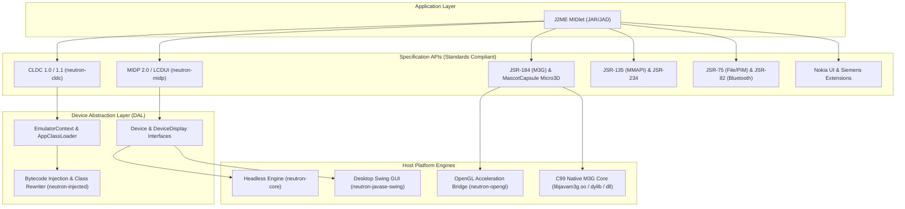

# NEUTRON — ARCHITECTURE REVIEW

## 1. EXECUTIVE ARCHITECTURAL SUMMARY

Neutron is a modern, modular Java ME (J2ME) runtime and emulation environment. The architecture is explicitly divided into decoupled layers to ensure strict separation between standard Java ME specification APIs, device abstraction layers (DAL), host platform adapters (J2SE/Swing/Headless), graphics acceleration engines, and media pipelines.

---

## 2. CORE RUNTIME & JVM COMPATIBILITY SUBSYSTEM

### 2.1 Classloader Isolation & Bytecode Transformation
- **Custom ClassLoader (`MIDletClassLoader` / `MIDletSystemClassLoader`)**: Isolates the running MIDlet from the host JVM classpath. It prevents games from directly accessing host Java SE APIs (`java.lang.System.exit`, `java.io.File`, `java.awt.*`, `java.net.Socket`) outside the sanctioned GCF / JSR boundaries.
- **Bytecode Instrumentation (`neutron-injected`)**:
  - Automatically rewrites bytecode calls to `Thread.sleep()`, `System.currentTimeMillis()`, and `System.gc()` to allow fine-grained frame pacing, virtual clock speed scaling, and deterministic memory limits.
  - Rewrites finalizers and static initializers to prevent cross-suite memory contamination.

### 2.2 MIDlet Lifecycle & State Transitions
- Compliance with MIDP 2.0 specification:
  - `startApp()`: Invoked on the primary event dispatch thread.
  - `pauseApp()`: Signals MIDlet to release non-essential resources and pause background threads.
  - `destroyApp(boolean unconditional)`: Forces teardown.
- **Defect Identified**: Stoppage of unresponsive threads historically relied on `Thread.stop()`, which has been completely removed in modern JVMs (Java 20+), raising `UnsupportedOperationException`. Cooperative thread interruption with timeout join guarantees must replace it.

---

## 3. LCDUI & GRAPHICS SUBSYSTEM

### 3.1 Display, Displayable & Canvas Pipeline
- **Thread Model**: LCDUI strictly requires that all UI modifications occur on the Event Dispatch Thread (EDT) or are synchronized with the display lock.
- **Canvas vs. GameCanvas**:
  - `Canvas` relies on asynchronous `repaint()` calls routed through `paint(Graphics g)`.
  - `GameCanvas` features an internal offscreen buffer updated directly via `getGraphics()` and flushed synchronously via `flushGraphics()`.
- **Coordinate Space & Transformation**:
  - J2ME specifies top-left origin `(0,0)` with integer coordinates.
  - Sprite and TiledLayer implementations support 8 affine transformations: `TRANS_NONE`, `TRANS_ROT90`, `TRANS_ROT180`, `TRANS_ROT270`, `TRANS_MIRROR`, `TRANS_MIRROR_ROT90`, `TRANS_MIRROR_ROT180`, `TRANS_MIRROR_ROT270`.
  - In `J2SEDisplayGraphics`, mathematical offsets for `TRANS_MIRROR_ROT270` exhibited clipping anomalies when image dimensions were non-square.

### 3.2 Alpha Compositing & Pixel Mathematics
- Software graphics rasterizer in `J2SEDisplayGraphics` converts ARGB pixel arrays using integer bit-shifts.
- **Color Corruption Defect**: Standard bit shift `((src * a) >> 8)` approximates division by 256 rather than 255. When compounding across transparent layers or reading pixel buffers, this causes a progressive darkening effect (e.g. 255 becomes 253). Proper rounding `((src * a + 128) >> 8)` or lookup-table acceleration is required.

---

## 4. 3D GRAPHICS ENGINES (M3G & MICRO3D)

### 4.1 JSR-184 (Mobile 3D Graphics API) Architecture
- **Dual-Tier Engine**:
  - **High-Level Scene Graph**: Java API in `javax.microedition.m3g.*` representing Nodes, Groups, World, Mesh, Camera, Light, and KeyframeSequence.
  - **Low-Level Native C99 Renderer**: Nokia-derived reference implementation compiled into `libjavam3g.so` (Linux), `libjavam3g.dylib` (macOS), and `javam3g.dll` (Windows).
  - **Desktop OpenGL Bridge (`neutron-opengl`)**: Provides modern hardware acceleration via OpenGL 2.1 / GLES 2.0 shaders (`neutron.vsh`, `neutron.fsh`).
- **Memory & Finalization Model**:
  - Java `Object3D` instances hold raw 64-bit native pointers (`long handle`).
  - Native destructors called via `finalize()` caused use-after-free and SIGSEGV when the native interface was torn down before garbage collection finished.

### 4.2 MascotCapsule Micro3D v3 Subsystem
- **Reverse-Engineered Pipeline**: Implements the proprietary Hi-Corp MascotCapsule Micro3D v3 API used by hundreds of Japanese and European 3D titles.
- **Features Supported**:
  - Model and ActionTable parsing (bones, skins, keyframe animations).
  - Software transformation pipeline: Fixed-point matrix arithmetic, lighting normals, toon shading, texture coordinate mapping.
  - Fallback: Software rasterizer operates completely headless without requiring an active X11/Wayland display.

---

## 5. MULTIMEDIA & AUDIO SUBSYSTEM (MMAPI / JSR-135)

### 5.1 Protocol Handlers & Decoders
- `Manager.createPlayer(InputStream stream, String type)` and `Manager.createPlayer(String locator)`.
- **Supported Formats**:
  - `audio/x-wav` & `audio/basic` (AU): Decoded via Java Sound `AudioSystem` and `Clip`.
  - `audio/midi`: Decoded using host JVM `MidiSystem` sequencer and software synthesizer.
  - Tone generation (`Manager.playTone()`): Synthesized square/sine wave generator.

### 5.2 Threading & Resource Leaks
- Audio players spawn asynchronous playback threads.
- Defect identified in `MidiAudioPlayer`: The `open()` method unconditionally returned `false`, and `realize()` / `prefetch()` were empty stubs, preventing MIDI initialization and leaking `Synthesizer` instances on exit.

---

## 6. RECORD MANAGEMENT SYSTEM (RMS) & PERSISTENCE

### 6.1 Storage Strategy
- `FileRecordStoreManager` serializes records into individual files per suite under `.microemulator/recordstores/`.
- File structure: Header (version, record counter, next ID) followed by serialized record blocks with sizes and byte arrays.

### 6.2 Atomicity & Data Integrity Defect
- Standard implementation opened `FileOutputStream(recordStoreFile)` directly on the target file, immediately truncating it to 0 bytes before writing new data.
- Any crash, exception, or power disruption mid-write permanently destroys user save data. Must be replaced with atomic file write-and-replace (`Files.move` with `ATOMIC_MOVE`).

---

## 7. NETWORKING & GENERIC CONNECTION FRAMEWORK (GCF)

### 7.1 Protocol Architecture
- CLDC GCF (`Connector.open()`) delegates via URL schemes:
  - `http://` / `https://` -> `HttpConnection` / `HttpsConnection` (backed by Java SE `HttpURLConnection`).
  - `socket://` -> `SocketConnection` (backed by `java.net.Socket`).
  - `datagram://` -> `DatagramConnection` (backed by `java.net.DatagramSocket`).
  - `file://` -> JSR-75 `FileConnection`.
- Thread safety and timeout management: Neutron isolates connection timeout loops from the UI thread to prevent UI lockups during network latency.

