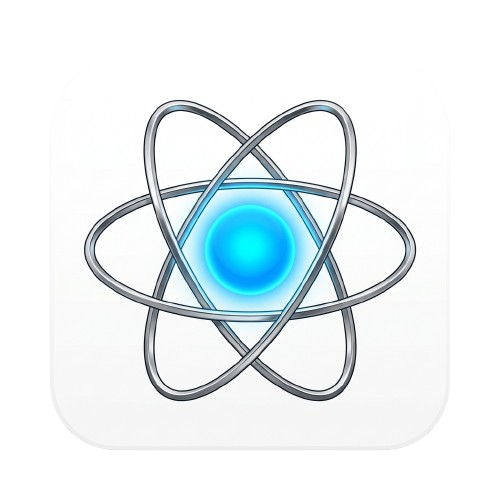
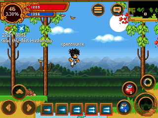
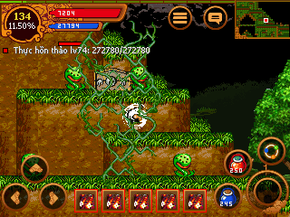
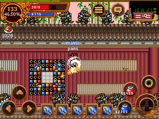
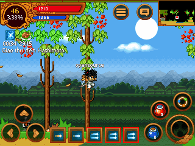

<p align="center">
  
</p>

<h1 align="center">Neutron</h1>

<p align="center">
  <strong>The Modern, High-Performance Java ME (J2ME) Emulator & Runtime Engine</strong>
</p>

<p align="center">
  <a href="https://neutron-emu.vercel.app"></a>
  <a href="https://github.com/nsomatrix/neutron/releases"></a>
  
  
  
  
</p>

---

## ⚡ Overview

**Neutron** is a modern, high-precision Java ME (Micro Edition) emulator and preservation environment engineered for running classic MIDP/CLDC applications and games across modern desktop operating systems (**Windows**, **macOS**, and **Linux**).

Rather than relying on slow, interpreted CPU emulation, Neutron executes mobile Java bytecode **directly on top of the host Java Virtual Machine (JVM)** via custom classloader injection (`MIDletClassLoader`). This architectural approach delivers native JIT execution speeds, microsecond latency, and sub-second startup times.

---

## 🎮 Gameplay Showcase

<p align="center">
  
  
</p>
<p align="center">
  
  
</p>

---

## 🌟 Key Features

### 🚀 Direct JIT Native Performance
- **Zero Overhead:** Emulates MIDlet bytecode directly via host JVM JIT compilers (HotSpot / GraalVM).
- **Configurable Heap:** Set virtual memory boundaries (32 MB, 64 MB, 128 MB, 256 MB, 512 MB, or Unlimited).
- **Dynamic Clock Speed:** Throttle or accelerate emulation speed smoothly from **0.5x up to 3.0x**.
- **Sleep Mode (`Ctrl+L`):** Automatically injects micro-sleeps into the render loop when idle, eliminating unwanted host CPU drain.

### 🧊 3D Graphics & Mobile Extensions
- **MascotCapsule Micro3D v3 (`com.mascotcapsule.micro3d.v3.*`):** Complete pure-Java software rasterizer. Enables running historic 3D mobile games utilizing 3D figures (`.mbac`), action bone tables (`.mtac`), affine transforms, lighting, and spherical environment mapping.
- **JSR-184 Mobile 3D Graphics (M3G):** Comprehensive binary `.m3g` chunk stream parser with Zlib deflation and Adler-32 integrity validation. Supports retained/immediate mode scene graphs, meshes, skinned meshes, morph targets, keyframe animations, cameras, and materials.
- **Nokia UI DirectGraphics:** 32-bit ARGB `drawPixels` manipulation, transparency masking, and 8-way rotations.
- **JSR-226 (SVG Mobile / Scalable 2D):** Full vector graphics support via `javax.microedition.m2g.*`.
- **Manufacturer OEM APIs:** Native stubs and implementations for Sony Ericsson, Motorola, and Samsung device APIs (Backlight, Vibration, Sound).

### 🎨 High-Definition xBRZ Scalers & Retro Shaders
- **xBRZ Scaling (2x, 3x, 4x, 5x, 6x):** Pure-Java implementation of the rule-based xBRZ algorithm, smoothing pixel-art diagonals and curves into high-resolution graphics without blur.
- **Classic Scalers:** Nearest Neighbor, Scale2x, Bilinear, and Bicubic interpolation.
- **Retro Screen Shaders:** Authentic horizontal **CRT Scanlines** and handheld **LCD subpixel dot-matrix grids**.
- **Hardware Post-Processing:** In-app sliders for Brightness, Contrast, Gamma curve, Saturation (monochrome mode), Sharpness, Phosphor Ghosting, and Color Inversion.
- **Borderless Fullscreen (`F11`):** Immersive fullscreen display featuring auto-hiding navigation bars and overlay HUDs.

### 🕹️ Interactive Virtual Keypad (`Ctrl+B`)
- **Built for Modern Devices:** Designed specifically for touchscreen laptops, tablets, and handheld PCs (e.g., Steam Deck, ROG Ally, Legion Go) or mouse-driven play.
- **8-Way Directional Pad:** Features standard arrows and diagonal directional buttons (↖ ↗ ↙ ↘) for smooth isometric navigation.
- **12-Key Phone Keypad:** Full numeric buttons (0–9, \*, #) with intelligent auto-repeat.
- **Form Auto-Paste:** Typing or clicking virtual numbers instantly feeds characters into active LCDUI textboxes.

### 🔊 MMAPI Audio & Synthesis
- **Sampled Audio:** Low-latency playback for WAV (PCM) and Sun AU audio clips.
- **AMR Voice Playback:** Native decoding and playback for mobile `.amr` ringtones and voice tracks.
- **Java Sound MIDI Engine:** Full polyphonic MIDI synthesizer with continuous, non-destructive looping.
- **Tone Generator:** Real-time synthesis of J2ME frequency tone sequences and buzzer effects.
- **JSR-234 (AMMS):** 3D positional spectator audio, sound source locations, reverb, and equalizer effect controls.

### 💾 Storage & Snapshot Management
- **Record Management System (RMS):** Persistent disk storage (`.rms` files) isolated per game suite (`~/.neutron/suite-[MIDletName]/`), with an optional in-memory mode (`--rms memory`).
- **RMS Inspector Dialog:** Browse, inspect byte lengths, edit hex/strings, or delete saved records in real time.
- **JSR-75 (FileConnection):** Virtual filesystem drives (`root/`, `memory_card/`, `c:/`) with path-traversal protection (`../`) and strict read-only mode validation.
- **Snapshot Manager:** Export the entire emulator configuration and RMS save data into a portable `.zip` backup or restore it onto another system.

### 🌐 Network & Developer Diagnostics
- **Generic Connection Framework (GCF):** Full support for HTTP, HTTPS, TCP streaming sockets, and UDP datagrams.
- **Airplane Mode:** Instant one-click master kill switch to isolate network requests for privacy or offline game testing.
- **X-Proxy:** Route GCF traffic through HTTP or SOCKS5 proxies with optional authentication.
- **Diagnostics Suite:** Real-time Performance HUD (live FPS & frame timings), Log Console, and GCF Network Packet Capture.

---

## 📦 Dual-Distribution Architecture

Neutron is distributed in two release packages to fit any use case:

| Distribution | JAR File | Typical Size | Description |
|--------------|----------|--------------|-------------|
| **Neutron Express** | `neutron-1.4.0.jar` | **~2.2 MB** | Full-featured desktop edition featuring FlatLaf themes (macOS Dark/Light, Dracula, IntelliJ), Library Explorer, and graphical controls. |
| **Neutron Core** | `neutron-core-1.4.0.jar` | **~840 KB** | Ultra-compact distribution with a high-ratio LZMA2/XZ payload decompressor (`CoreLauncher`). Boots in milliseconds with minimal RAM overhead. |

Both editions include identical J2ME subsystem support, 3D engines, scalers, and audio playback.

---

## 🚀 Quick Start

### 1. Requirements
- **Java Runtime:** Java 8+ (JRE or JDK). **Java 17+ or 21+ LTS** ([Eclipse Temurin](https://adoptium.net/)) is strongly recommended.
- **Linux Audio:** On Linux systems, install the ALSA runtime: `sudo apt install libasound2` (or `alsa-lib` on Fedora/Arch).

### 2. Download Pre-Built Release
Grab the latest release binaries from our [Download Page](https://neutron-emu.vercel.app/download) or [GitHub Releases](https://github.com/nsomatrix/neutron/releases):

```bash
# Download Neutron Express
curl -LO https://github.com/nsomatrix/neutron/releases/download/1.4.0/neutron-1.4.0.jar

# Or download Neutron Core
curl -LO https://github.com/nsomatrix/neutron/releases/download/1.4.0/neutron-core-1.4.0.jar
```

### 3. Running a Game

```bash
# Launch GUI directly
java -jar neutron-1.4.0.jar

# Launch a game immediately from the terminal
java -jar neutron-1.4.0.jar path/to/game.jar

# Run with a custom screen resolution (e.g. 240x320)
java -jar neutron-1.4.0.jar --resizableDevice 240 320 path/to/game.jar

# Run ultra-compact Core edition
java -jar neutron-core-1.4.0.jar path/to/game.jar
```

---

## 🎮 Default Controls

| Input Device | Desktop Binding | J2ME Mobile Key | Action |
|--------------|-----------------|-----------------|--------|
| **Keyboard** | **F1** | Left Soft Key (`SOFT1`) | Left Menu / Confirm |
| **Keyboard** | **F2** | Right Soft Key (`SOFT2`) | Right Menu / Back / Exit |
| **Keyboard** | **Enter** | `SELECT` / `FIRE` | Confirm / Action |
| **Keyboard** | **Arrow Keys** (↑ ↓ ← →) | `UP`, `DOWN`, `LEFT`, `RIGHT` | 4-Way D-Pad Navigation |
| **Keyboard** | **Keypad 0–9** | `KEY_NUM0` – `KEY_NUM9` | Phone Number Keys |
| **Keyboard** | **Multiply (\*)** | `KEY_STAR` | Star Key (`*`) |
| **Keyboard** | **Subtract (-)** | `KEY_POUND` | Pound Key (`#`) |
| **Mouse / Touch**| **Left Click / Drag** | Stylus Pointer Events | Touchscreen Tap & Drag |
| **Virtual Pad** | **`Ctrl+B`** | Full Keypad Overlay | 8-Way D-Pad, Softkeys & Numpad |

---

## 💻 Building From Source

Neutron uses a modular Gradle build setup.

### Prerequisites
- **JDK 17+** with `javac` and jar packaging tools.
- **Git**

```bash
# 1. Clone the repository
git clone https://github.com/nsomatrix/neutron.git
cd neutron

# 2. Build release JARs for all modules
./gradlew jar

# 3. Launch both the Full and Core versions simultaneously
./gradlew run

# 4. Or execute unit tests
./gradlew test
```

Compiled JARs will be generated under:
- `neutron/neutron-javase-swing/build/libs/neutron-javase-swing-1.4.0.jar`
- `neutron/neutron-core/build/libs/neutron-core-1.4.0.jar`

---

## 🌐 Documentation & Web Hub (`neutron-emu`)

The documentation portal and interactive web UI are built with **Next.js** and **Tailwind CSS**:

```bash
cd neutron-emu
npm install
npm run dev
```

Visit [http://localhost:3000](http://localhost:3000) or check the live production site at [neutron-emu.vercel.app](https://neutron-emu.vercel.app).

---

## 📁 Repository Structure

```text
neutron/
├── neutron/
│   ├── api/                     # CLDC 1.0, 1.1, and MIDP 2.0 API interfaces
│   ├── neutron-core/            # Minimal launcher with LZMA2/XZ payload decompressor
│   ├── neutron-javase-swing/    # Modern FlatLaf Swing desktop GUI, scalers, and keypad
│   ├── neutron-javase/          # Host Java SE platform bridges (audio, graphics, input)
│   ├── neutron-midp/            # LCDUI widgets, Game API, RMS implementation
│   ├── neutron-cldc/            # CLDC standard library and GCF networking
│   └── neutron-extensions/      # 3D engines, Nokia UI, AMMS, JSR-75, OEM APIs
│       ├── neutron-micro3d/     # MascotCapsule Micro3D v3 pure-Java rasterizer
│       ├── neutron-jsr-184/     # JSR-184 (M3G) 3D engine and binary chunk parser
│       ├── neutron-nokiaui/     # Nokia UI DirectGraphics (32-bit ARGB drawPixels)
│       ├── neutron-jsr-75/      # FileConnection filesystem and virtual roots
│       ├── neutron-jsr-135/     # MMAPI audio players (WAV, AU, AMR, MIDI, tones)
│       ├── neutron-jsr-234/     # AMMS 3D audio effects, equalizer, reverb
│       ├── neutron-jsr-226/     # Scalable 2D vector graphics (SVG)
│       └── neutron-oem-apis/    # Sony Ericsson, Motorola, Samsung device APIs
├── neutron-emu/                 # Next.js web portal, search engine, and doc site
├── build.gradle                 # Multi-project Gradle build configuration
└── settings.gradle              # Gradle subproject definitions
```

---

## 📜 License

Neutron is open-source software dual-licensed under:
- **[GNU Lesser General Public License (LGPL) v2.1](file:///home/manish/projects/neutron/neutron/COPYING-LGPL-2.1)**
- **[Apache License 2.0](file:///home/manish/projects/neutron/neutron/COPYING-AL-2.0)**

You may choose either license according to your distribution and deployment requirements. See the [`neutron/COPYING`](file:///home/manish/projects/neutron/neutron/COPYING) file for full details.
