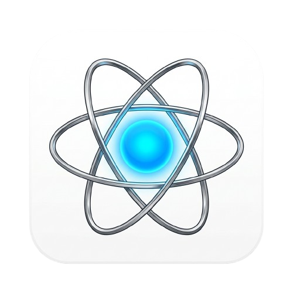
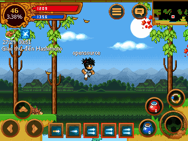
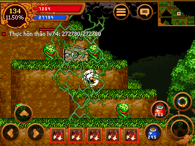
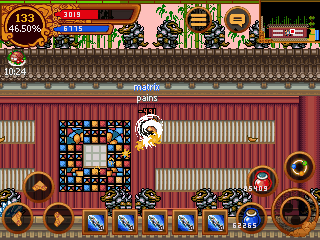
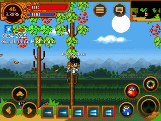

<p align="center">
  
</p>

<h1 align="center">Neutron</h1>

<p align="center">
  <strong>The Modern, High-Performance Java ME (J2ME) Emulator & Runtime Engine</strong>
</p>

<p align="center">
  <a href="https://neutron-emu.vercel.app"></a>
  <a href="https://github.com/nsomatrix/neutron/releases"></a>
  
  
  
  
</p>

---

## Overview

**Neutron** is a cross-platform Java ME (MIDP 2.0 / CLDC 1.1) emulator for **Windows**, **macOS**, and **Linux**.

Instead of interpreting mobile instructions step-by-step, Neutron adapts MIDlet bytecode at load time so it runs directly on your desktop Java Virtual Machine. Games start quickly, run smoothly at native speed, and use minimal system memory.

---

## Gameplay Showcase

<p align="center">
  
  
</p>
<p align="center">
  
  
</p>

---

## Capabilities

### Emulation & Performance
- **Native JVM Execution:** Runs MIDlets directly on HotSpot or GraalVM without CPU interpretation overhead.
- **Speed & Memory Control:** Adjustable emulation speed (`0.5x` to `3.0x`), configurable heap limits, and an idle sleep toggle (`Ctrl+L`) to reduce background CPU usage.
- **Flexible Launch Options:** Drag-and-drop `.jar` or `.jad` files, load from a URL, launch from the command line, or organize local collections with the built-in Library Explorer.

### Display, Scaling & Themes
- **Image Scaling:** Nearest Neighbor, Scale2x, Bilinear, Bicubic, and xBRZ (`2x` to `6x`) filters.
- **Retro Filters & Color Controls:** Optional CRT scanlines and LCD grid overlays, plus live sliders for brightness, contrast, gamma, saturation, sharpness, ghosting, and color inversion.
- **Window Modes:** Borderless fullscreen (`F11`) and preset or custom screen resolutions (`--resizableDevice`).
- **Desktop Themes (Express):** Light, Dark, IntelliJ, Dracula, macOS Light, and macOS Dark UI themes.

### 3D, Audio & Mobile Extensions
- **3D & Vector Graphics:** Software implementations for JSR-184 (M3G), MascotCapsule Micro3D v3, and JSR-226 (SVG).
- **Vendor APIs:** Support for Nokia UI, Siemens, Sony Ericsson, Motorola, and Samsung mobile extensions.
- **Audio & Media:** Polyphonic MIDI playback, WAV/AU sampled audio, AMR voice clips, tone synthesis, and JSR-234 audio controls.

### Storage, Networking & Diagnostics
- **Game Saves & Backups:** Persistent `RecordStore` saves per game suite (`~/.neutron/`), an in-app RMS Inspector for viewing or editing saved data, an optional in-memory mode (`--rms memory`), and `.zip` snapshot backup/restore.
- **File Access:** Sandboxed virtual filesystem support for JSR-75 (`FileConnection`).
- **Networking & Privacy:** HTTP, HTTPS, TCP socket, and UDP datagram support with one-click offline Airplane Mode and HTTP/SOCKS5 proxy configuration.
- **Diagnostics:** Live FPS/timing HUD, Log Console, and Network Activity monitor.

---

## Release Editions

Neutron is published as two self-contained executable JARs with identical J2ME API and game compatibility:

| Edition | File | Size | SHA-256 Checksum | Notes |
|---------|------|------|------------------|-------|
| **Neutron Express** | `neutron-1.5.0.jar` | ~759 KB | `3c30d374c68a90a50fe8b4d3215e8166a1f400df3320fff5d58fc230a8f20b30` | Full desktop edition with FlatLaf themes, Library Explorer, and graphical menus. |
| **Neutron Core** | `neutron-core-1.5.0.jar` | ~507 KB | `2a8d3e66accb08e6804c0b8f85d24fc6d99846a6f6a3c8939757ee8fc23cc3f0` | Compact edition without third-party look-and-feel dependencies, tuned for minimal disk and RAM usage. |

---

## Getting Started

### Prerequisites
- **Java:** Java 8 or newer (JRE or JDK). **Java 17 or 21 LTS** from [Adoptium](https://adoptium.net/) is recommended.
- **Linux Audio (optional):** Install ALSA libraries if sound is unavailable (`sudo apt install libasound2` on Debian/Ubuntu, or `alsa-lib` on Fedora/Arch).

### Download

Download from the [Download Page](https://neutron-emu.vercel.app/download) or [GitHub Releases](https://github.com/nsomatrix/neutron/releases):

```bash
# Neutron Express (Full Desktop GUI)
curl -LO https://github.com/nsomatrix/neutron/releases/download/1.5.0/neutron-1.5.0.jar

# Neutron Core (Compact Edition)
curl -LO https://github.com/nsomatrix/neutron/releases/download/1.5.0/neutron-core-1.5.0.jar
```

### Run

```bash
# Open the desktop UI
java -jar neutron-1.5.0.jar

# Launch a game directly
java -jar neutron-1.5.0.jar path/to/game.jar

# Launch with a custom screen size (width x height)
java -jar neutron-1.5.0.jar --resizableDevice 240 320 path/to/game.jar

# Run Neutron Core
java -jar neutron-core-1.5.0.jar path/to/game.jar
```

---

## Default Controls

| Input | Binding | J2ME Key | Function |
|-------|---------|----------|----------|
| Keyboard | `F1` | `SOFT1` | Left soft key / Menu |
| Keyboard | `F2` | `SOFT2` | Right soft key / Back |
| Keyboard | `Enter` | `SELECT` / `FIRE` | Confirm / Action |
| Keyboard | Arrow keys | `UP`, `DOWN`, `LEFT`, `RIGHT` | Directional pad |
| Keyboard | `0` – `9` | `KEY_NUM0` – `KEY_NUM9` | Numeric keypad |
| Keyboard | `*` | `KEY_STAR` | Star key |
| Keyboard | `-` | `KEY_POUND` | Pound (`#`) key |
| Mouse / Touch | Click / Drag | Pointer events | Touchscreen tap and drag |
| Virtual Keypad | `Ctrl+B` | All mobile keys | On-screen 8-way D-pad, softkeys, and numpad |

---

## Building From Source

Neutron uses a multi-module Gradle build with separate **dev** (fast, un-obfuscated, full debug symbols) and **release** (shrunk, optimized, standalone packed JARs) modes.

### Prerequisites
- **JDK 17+** (recommended; builds Java 8 bytecode via the included `./gradlew` wrapper)
- **Git**

### Common Commands

```bash
# Clone the repository
git clone https://github.com/nsomatrix/neutron.git
cd neutron

# Build runnable dev JARs across all modules (fast incremental build)
./gradlew assemble

# Run all unit tests (dev mode)
./gradlew test

# Build and launch both Express and Core dev JARs
./gradlew run

# Build packed standalone release JARs (ProGuard + XZ)
./gradlew release -PbuildType=release

# Build and run the full release verification gate (archive, CLI, reflection, FlatLaf, headless & GUI smoke MIDlet)
./gradlew verifyRelease -PbuildType=release

# Clean all subproject and root build outputs
./gradlew clean
```

### Build Outputs
- **Dev JARs (default `buildType=dev`):**
  - `neutron/neutron-javase-swing/build/libs/dev/neutron-javase-swing-1.5.0.jar`
  - `neutron/neutron-core/build/libs/dev/neutron-core-1.5.0.jar`
- **Release JARs (`-PbuildType=release`):**
  - `neutron/neutron-javase-swing/build/libs/release/neutron-javase-swing-1.5.0.jar`
  - `neutron/neutron-core/build/libs/release/neutron-core-1.5.0.jar`
- **ProGuard Diagnostics (Release):**
  - Mapping, seed, and usage reports under `build/outputs/mapping/` in each application module.

See [builds.txt](builds.txt) for the full list of per-module commands.

---

## Documentation Portal (`neutron-emu`)

The documentation website in `neutron-emu/` is built with Next.js and Tailwind CSS:

```bash
cd neutron-emu
npm install
npm run dev
```

Open [http://localhost:3000](http://localhost:3000), or view the live documentation at [neutron-emu.vercel.app](https://neutron-emu.vercel.app).

---

## Repository Structure

```text
neutron/
├── build-logic/                 # Gradle convention plugins and custom build/verification tasks
├── gradle/                      # Gradle wrapper and centralized version catalog (libs.versions.toml)
├── neutron/
│   ├── api/                     # CLDC 1.0, CLDC 1.1, and MIDP 2.0 API stubs
│   ├── neutron-cldc/            # CLDC runtime and Generic Connection Framework core
│   ├── neutron-midp/            # LCDUI components, Game API, and RecordStore
│   ├── neutron-javase/          # Java SE platform bridge, classloader instrumentation, and networking
│   ├── neutron-javase-swing/    # Neutron Express desktop UI, scalers, shaders, and SwingLauncher
│   ├── neutron-core/            # Neutron Core minimal edition and CoreLauncher
│   ├── neutron-injected/        # Runtime classes injected for applet/MIDlet compatibility
│   ├── neutron-extensions/      # JSR extensions (M3G, Micro3D, NokiaUI, JSR-75, MMAPI, AMMS, SVG, OEM APIs)
│   ├── neutron-examples/        # Sample MIDlets (demo and file viewer)
│   └── neutron-tests/           # Unit test MIDlets, bytecode tests, and release E2E smoke MIDlet
├── neutron-emu/                 # Next.js documentation and download portal
├── build.gradle                 # Root build lifecycle tasks (run, release, verifyRelease)
├── settings.gradle              # Subproject declarations and dependency repository configuration
├── gradle.properties            # Default build mode and Gradle caching/parallel settings
└── builds.txt                   # Quick reference for dev, release, and clean commands
```

---

## License

Neutron is dual-licensed under:
- [GNU Lesser General Public License (LGPL) v2.1](neutron/COPYING-LGPL-2.1)
- [Apache License 2.0](neutron/COPYING-AL-2.0)

See [neutron/COPYING](neutron/COPYING) for full licensing terms.
