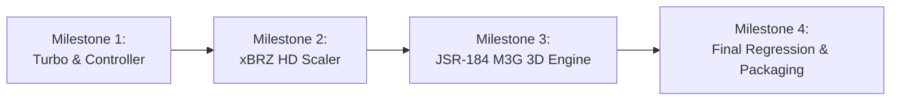

# Neutron Emulator: 100% Compatibility & Beast Mode Roadmap

This document outlines the architectural milestones, design specifications, and implementation roadmap to elevate **Neutron** into a high-performance, 100% compatible J2ME emulator with modern emulation quality-of-life (QoL) capabilities.

---

## Architecture Principles
1. **Industry-Standard Modularity**: Maintain clean separation between CLDC/MIDP core specifications, platform/OEM extensions, and the Swing desktop presentation tier. Zero circular dependencies.
2. **Pure Java Execution**: Avoid fragile native JNI binaries wherever possible. Ensure all features (including 3D graphics and audio) run cross-platform (Linux, Windows, macOS) out of the box.
3. **Defensive Observability**: Guarantee that all background threads, classloaders, and renderers log meaningful diagnostics at appropriate log levels instead of silently discarding exceptions.
4. **Zero Regression Guarantee**: Every milestone must compile against Java 8 bytecode specifications, pass existing subproject test suites, and maintain backward compatibility with 2D titles (*Avatar LA PRO*, *Bounce Tales*).

---

## Milestone Overview

---

## Phase 1: Turbo Fast-Forward & Controller Support (Pending User Redesign)
* **Status:** Open for custom user implementation
* **Goals:**
  1. **Dynamic Engine Speed Multiplier (Turbo):** Custom user implementation.
  2. **Modern Controller / Gamepad Input Mapping:** Custom user implementation.

---

## Phase 2: High-Definition xBRZ Pixel-Art Upscaler
* **Target Module:** `neutron-javase-swing`
* **Goals:**
  1. **Pure-Java xBRZ Scaling Engine:**
     - Implement high-performance multi-threaded xBRZ filter ($2\times$, $3\times$, $4\times$, $5\times$, $6\times$) analyzing pixel color gradients, edge detection, and corner blending.
     - Support bilinear, nearest-neighbor (pixel perfect), and xBRZ filtering modes.
  2. **UI Integration:**
     - Add `View -> Texture Filter` menu with instant real-time toggle:
       - `Pixel Perfect (Nearest Neighbor)`
       - `Smooth (Bilinear)`
       - `xBRZ High Definition (2x, 3x, 4x)`
     - Integrate cleanly into `SwingDisplayComponent.paintComponent()` with zero frame latency.

---

## Phase 3: JSR-184 (M3G) 3D Graphics Engine
* **Target Modules:** `:neutron:neutron-extensions:neutron-jsr-184`, `:neutron:neutron-javase-swing`, `:neutron:neutron-core`
* **Goals:**
  1. **New Extension Module `:neutron:neutron-extensions:neutron-jsr-184`:**
     - Complete implementation of `javax.microedition.m3g.*` per JSR-184 specification.
     - **Scene Graph:** `World`, `Camera`, `Light`, `Group`, `Node`, `Mesh`, `SkinnedMesh`, `MorphingMesh`.
     - **Materials & Textures:** `Appearance`, `Material`, `PolygonMode`, `CompositingMode`, `Texture2D`, `Image2D`, `Fog`, `Background`.
     - **Geometry & Arrays:** `VertexBuffer`, `VertexArray`, `IndexBuffer`, `TriangleStripArray`.
     - **Animations & Math:** `AnimationController`, `AnimationTrack`, `KeyframeSequence`, `Transform`, `RayIntersection`.
     - **Model Parser:** `Loader` for binary `.m3g` 3D files.
  2. **High-Performance Pure-Java Software 3D Rasterizer:**
     - Perspective-correct affine texture mapping.
     - Depth buffering (Z-buffer with 16-bit / 24-bit precision).
     - Gouraud shading and directional/positional lighting calculations.
     - Alpha testing, blending, and fogging.
     - Direct rendering into target `Graphics` / `Image` raster buffers.
  3. **Build & Packaging Integration:**
     - Register in `settings.gradle`.
     - Add implementation dependency to `neutron-javase-swing` and `neutron-core`.
     - Package into standalone fat distribution jars (`neutron-javase-swing-1.4.0.jar` and `neutron-core-1.4.0.jar`).

---

## Phase 4: Verification & Integration Testing
* Run full `./gradlew test` across all subprojects.
* Verify 2D backward compatibility (*Avatar LA PRO*, *Bounce Tales*).
* Verify 3D game execution on M3G titles (*Asphalt 3D*, *Galaxy on Fire*).

