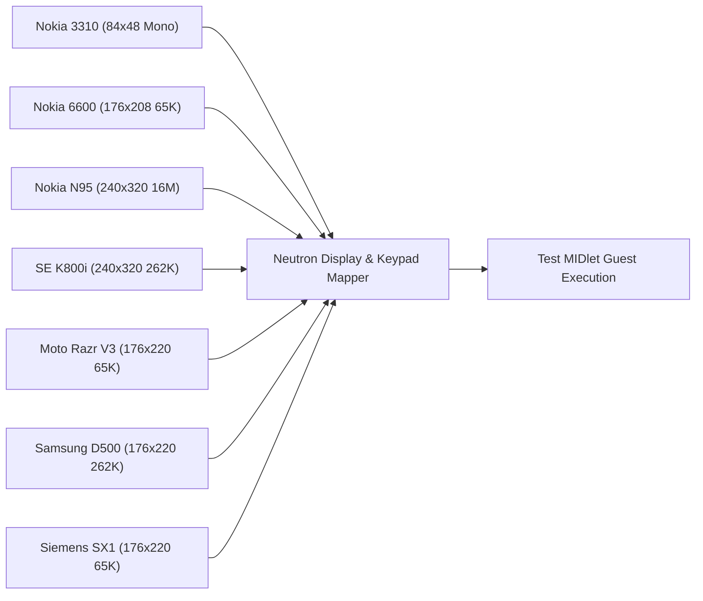

# Neutron Device Compatibility & Handset Profiles Guide

## 1. Handset Profile Architecture

Historical Java ME devices varied widely in display dimensions, color depth, heap capacity, audio synthesis capabilities, and OEM-specific input key mappings.

The Neutron Universal Testing Framework provides pre-configured device profile definitions in `device-profiles/` that mirror historical hardware specifications.



---

## 2. Supported Historical Handset Profiles

The framework includes 10 comprehensive handset profiles:

| Profile Identifier | Handset Model | Year | Screen Resolution | Color Depth | Heap Limit | Key APIs Supported |
| :--- | :--- | :--- | :--- | :--- | :--- | :--- |
| `nokia-3310.json` | Nokia 3310 (Rev 2) | 2002 | 84 x 48 | 1-bit Mono | 256 KB | CLDC 1.0, MIDP 1.0, Nokia UI |
| `nokia-6600.json` | Nokia 6600 (S60 2nd) | 2003 | 176 x 208 | 16-bit (65K) | 2 MB | CLDC 1.0, MIDP 2.0, MMAPI, Nokia UI |
| `nokia-n95.json` | Nokia N95 (S60 3rd) | 2007 | 240 x 320 | 24-bit (16M) | 18 MB | CLDC 1.1, MIDP 2.0, M3G, Micro3D, MMAPI, JSR-75 |
| `nokia-e72.json` | Nokia E72 (S60 3rd FP2)| 2009 | 320 x 240 (Landscape) | 24-bit (16M) | 32 MB | CLDC 1.1, MIDP 2.1, M3G, Micro3D, MMAPI, QWERTY |
| `sonyericsson-k750i.json`| Sony Ericsson K750i | 2005 | 176 x 220 | 18-bit (262K)| 4 MB | CLDC 1.1, MIDP 2.0, M3G, Micro3D v3, MMAPI |
| `sonyericsson-k800i.json`| Sony Ericsson K800i | 2006 | 240 x 320 | 18-bit (262K)| 8 MB | CLDC 1.1, MIDP 2.0, M3G, Micro3D v3, MMAPI, JSR-75 |
| `motorola-v3.json` | Motorola RAZR V3 | 2004 | 176 x 220 | 16-bit (65K) | 2 MB | CLDC 1.0, MIDP 2.0, MotoJUI, MMAPI |
| `samsung-d500.json` | Samsung SGH-D500 | 2004 | 176 x 220 | 18-bit (262K)| 3 MB | CLDC 1.1, MIDP 2.0, Samsung API, MMAPI |
| `siemens-sx1.json` | Siemens SX1 | 2003 | 176 x 220 | 16-bit (65K) | 2 MB | CLDC 1.0, MIDP 2.0, Siemens MP, Nokia UI |
| `modern-resizable.json` | Modern Generic Responsive| Modern | 480 x 640 | 32-bit ARGB | 256 MB | CLDC 1.1, MIDP 2.1, All Extensions |

---

## 3. Keycode Mapping Differences Across Vendors

One of the largest historical sources of fragmentation in J2ME gaming was keypad mapping differences for action keys and softkeys:

### 3.1 Standard ITU-T Keypad
All profiles map numbers 0–9, `*` (Star), and `#` (Pound) to their standard ASCII/Unicode equivalents:
- Key 0: `48` (`KEY_NUM0`)
- Key 1: `49` (`KEY_NUM1`)
- Key 9: `57` (`KEY_NUM9`)
- Key `*`: `42` (`KEY_STAR`)
- Key `#`: `35` (`KEY_POUND`)

### 3.2 Directional & Action Key Differences
| Action | Standard Canvas Code | Nokia Keycode | Sony Ericsson Keycode | Motorola Keycode |
| :--- | :--- | :--- | :--- | :--- |
| Up Arrow | `Canvas.UP` (-1) | `-1` | `-1` | `-1` |
| Down Arrow | `Canvas.DOWN` (-2) | `-2` | `-2` | `-2` |
| Left Arrow | `Canvas.LEFT` (-3) | `-3` | `-3` | `-3` |
| Right Arrow | `Canvas.RIGHT` (-4) | `-4` | `-4` | `-4` |
| Fire / Select | `Canvas.FIRE` (-5) | `-5` | `-5` | `-5` |
| Left Softkey | System Command | `-6` | `-6` | `-21` |
| Right Softkey| System Command | `-7` | `-7` | `-22` |
| Clear / Back | System Command | `-8` | `-11` | `-20` |

Neutron's input translation layer (`KeyMapper`) normalizes these codes so that both vendor-specific key handler logic and standard `Canvas.getGameAction(keyCode)` function reliably.

---

## 4. Applying Device Profiles in Neutron

Device profiles can be passed to Neutron to configure screen geometry, orientation, and memory constraints:

```bash
# Running with Nokia N95 configuration
java -Djava.awt.headless=true \
     -Dneutron.display.width=240 \
     -Dneutron.display.height=320 \
     -cp neutron/neutron-javase-swing/build/tmp/rawJar/neutron-javase-swing-raw-1.5.0.jar \
     org.neutron.app.Headless \
     --rms memory \
     neutron-universal-test-suite/test-jars/game2d-engine-stress.jar
```

